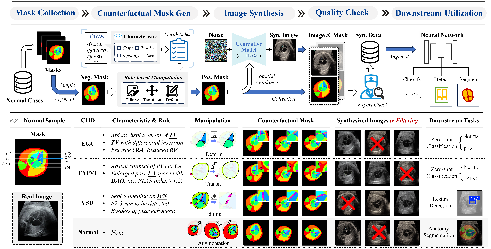
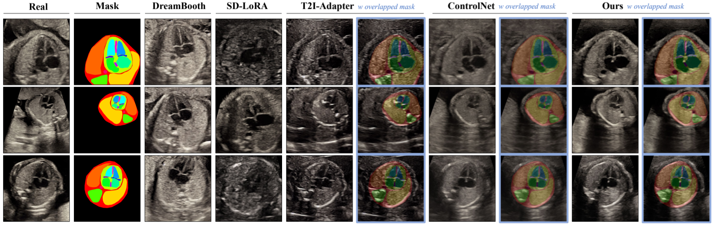
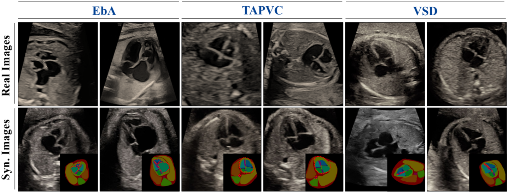
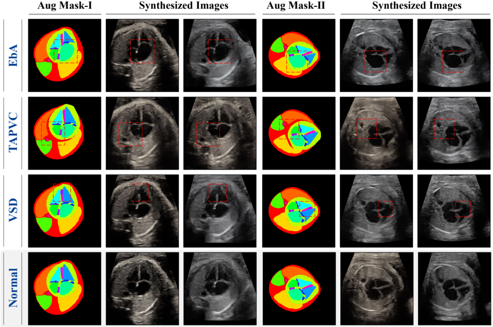

<h1 align="center">
     Pos4CHD: A Positive-Free Mask-Guided Counterfactual Synthesis Framework for Fetal Congenital Heart Defect Analysis
</h1></h1> 
<p align="center">
</p>

> Wenjie Xuan et al. Submitted to TMI. 

This is the official implementation for the paper "*Pos4CHD: A Positive-Free Mask-Guided Counterfactual Synthesis Framework for Fetal Congenital Heart Defect Analysis*". We propose Pos4CHD, a positive-free mask-guided counterfactual generation framework for fetal echocardiography, to alleviate CHD data scarcity. We first introduce FE-Gen for ultrasound generation, which mitigates histogram shift via regularization and improves spatial image-mask alignments via learnable semantic queries. Based on FE-Gen, Pos4CHD transforms normal masks into counterfactual ones and generates corresponding images, yielding pseudo-CHD image-mask pairs for downstream analysis.  Please refer to our paper for more details.


## :fire: News

- **[2026/10/23]**:  Release the inference codes and pretrained checkpoints for generative model, FE-Gen. We also provide our pretrained models for downstream tasks. 
- **[2026/10/06]**:  Start the github project. We are preparing codes and models, and will release them in a few weeks. 


## :round_pushpin: Todo

- [ ] Further curations of the code and instructions.
- [ ] Release Evaluation codes for generative models. 
- [x] Release the checkpoints of downstream models for CHD analysis. 
- [x] Release the codes for downstream tasks, including classification, detection, and segmentation.  
- [ ] Release the codes for generative model training. 
- [ ] Release the codes for CHD-like mask manipulation. 
- [x] Release the checkpoints of our FE-Gen.  
- [x] Release the codes and demo for inference and visualization with FE-Gen. 
- [x] Release the codes for preparing datasets and demos. 


## :sparkles: Highlight



- **A positive-free mask-to-image counterfactual generation framework**, namely Pos4CHD, to tackle the scarcity of fetal CHD cases, especially rare subtypes, which offers pseudo-positive image-mask pairs for diverse CHDs through rule-based counterfactual mask manipulation and mask-guided fetal ultrasound synthesis.
- **A mask-guided generative model for fetal echocardiography**, namely FE-Gen, realizing improved ultrasound fidelity and advanced image-mask alignment, which is trained on a collect normal fetal 4CH-view datasets with 14 anatomical annotations.
- **Promising results on versatile downstream real-world CHD analysis tasks.** Experiments together with expert evaluations and detailed ablations demonstrate the effectiveness of our synthesized samples for data augmentation across various downstream tasks, bringing consistent improvements on zero-shot CHD classification, lesion detection, and fetal heart anatomy segmentation. 


## :hammer_and_wrench: Install

**Recommended**:  `Python=3.10` `torch=2.8.0` `CUDA=12.2` `diffusers=0.36.0` `peft==0.18.0` `nnunetv2==2.6.2` `ultralytics==8.4.65` `numpy==2.2.6`

```shell
# set up repository 
git clone https://github.com/DREAMXFAR/Pos4CHD.git
cd Pos4CHD-main

# To avoid possible conflicts, we use two environments for generation and downstream tasks individually
# install conda environment for generation
conda env create -f env_pos4chd.yml

# install conda environment for downstream tasks
conda env create -f env_downstream_tasks.yml
```


## :pushpin: Checkpoints{#sec3}

> Here we provide the pre-trained parameters. 

1. Download the [SD_v1.5](https://huggingface.co/runwayml/stable-diffusion-v1-5) parameters first from hugging-face. Put the SD checkpoints in anywhere you like. 

2. You can download the following checkpoints and put them in `pretrained_models/`. 

   - Generative model, i.e., *FE-Gen*

     | Model  | Download                                                | Key  | Notations                                                    |
     | ------ | ------------------------------------------------------- | ---- | ------------------------------------------------------------ |
     | VAE    | [link](https://pan.baidu.com/s/1n2nbU6Qc302qHEP6er92_w) | chdp | The checkpoint of fine-tuned VAE.                            |
     | FE-Gen | [link](https://pan.baidu.com/s/11tcd1EOXmR6zxbhQjqohOg) | chdp | The checkpoint of FE-Gen model, including VAE, UNet-LoRA, and ControlNet paramters. |
   
   - Downstream models, including *ConvNeXt*, *Yolov5s*, *nnUNet*. 
   
     | Model          | Download                                                 | Key  | Notations                                                    |
     | -------------- | -------------------------------------------------------- | ---- | ------------------------------------------------------------ |
     | ConvNeXt-EbA   | [link](https://pan.baidu.com/s/1HxZ7HjtxUI1tbCqJ0P0CTQ ) | chdp | The checkpoint of ConvNeXt for EbA classification.           |
     | ConvNeXt-TAPVC | [link](https://pan.baidu.com/s/1Rthgdl5G27sCxQXK22cRkw)  | chdp | The checkpoint of ConvNeXt for TAPVC classification.         |
     | Yolov5s-VSD    | [link](https://pan.baidu.com/s/18FQcYcTa-nVmj7Xr1UKCrQ)  | chdp | The checkpoint of Yolov5s for VSD/IVS detection.             |
     | nnUNet-heart   | [link](https://pan.baidu.com/s/10v0ruLjuw2DBM3I4n8Z5Ug)  | chdp | The checkpoint of nnUNet for fetal heart ultrasound segmentation with 14 anatomical structures. |


## :rocket: Getting Started

> Here we suppose you are in `Pos4CHD-main/`

### Fetal Ultrasound Generation

#### (1) Demo

1. Run the following scripts to synthesize fetal heart images (with CHDs). Here we provide demo masks for normal and CHD-like ones in `./dataset/demo_masks` for illustration. 

   ```sh
   # 1. scripts
   # Please first download the pretrained models and config the model paths in inference.py
   bash scripts/run_demo.sh
   
   # the output images would be saved in ./output_dir/infer_demo.png.
   # Note: the class and color mapping refers to ./dataset/demo_dataset/class_map.json and color_map.json
   ```

#### (2) Data Preparation

 1. Here we provide a demo dataset for illustration in `./datasest/demo_dataset`. Note that the segmentation masks come from real samples with augmentations, but the images here are generated samples by our method for privacy concerns.

 2. The final data structure is as follows

    ```sh
    # file structures
    ./dataset/demo_dataset
      ├── train  # train data      
      │   ├── images  # images dir, containing xxx.png, etc
      │   ├── conditioning_images # conditiong images dir, formatted with class index
      │   ├── colorful_conditioning_images # colorful conditioning images dir
      │   └── metadata.jsonl    # metadata json
      ├── test  # test data with the same file structure as `train/`
      ├── class_map.json  # the class definition and mapping
      └── color_map.json  # the color definition and mapping for visualization
    ```

#### (3) Inference

1. Run the following scripts for batch inference for image generation. 

   ```shell
   # Configure the arguments first, then run batch generation
   # Definitions of arguments are provided in generate.py
   bash scipts/submit_batch_generation.sh
   ```

*Note: We will release the training codes and scripts, as well as mask manipulations, once our paper is accepted.* 


### Downstream Analysis Tasks

#### (1) Zero-shot classification

1. Download the official implementation of [ConvNeXt](https://github.com/facebookresearch/ConvNeXt) to `./downstream_tasks/`.

   ```shell
   # 1. download the ConvNeXt
   git clone https://github.com/facebookresearch/ConvNeXt.git
   # install the package following the official instructions
   
   # 2. move the project to our directory
   mv ConvNeXt ./downstream_tasks/
   ```

2. Prepare the data following the [official instructions](https://github.com/facebookresearch/ConvNeXt/blob/main/INSTALL.md#dataset-preparation). 

   ```shell
   # data set structures
   EbA_classification_dataset
   ├── readme.txt
   ├── test
   │   ├── class1
   │   └── class2
   └── train
       ├── class1
       └── class2
   
   # Notes:
   # - By default, class1 for negative, class2 for positive. 
   ```

3. Download the pretrained parameters, and put them in `ConvNeXt/pretrained_models`, including official [convnext_tiny_1k](https://github.com/facebookresearch/ConvNeXt#imagenet-22k-trained-models) and our [pretrained parameters.](#sec3) 

4. Here are our training scripts for reference. 

   ```shell
   # 1. copy our codes to substitute the original files
   cp main.py /path/to/ConvNeXt
   cp engine.py /path/to/ConvNeXt
   
   # 2. Configure the arguments first, according to your settings.
   
   # 3. Run the following scripts for training and evaluation
   bash scripts/run_convnext_EbA_gennegtrain.sh  # training EbA
   bash scripts/run_convnext_TAPVC_gennegtrain.sh  # training TAPVC
   
   bash scripts/run_evaluation.sh  # evaluation
   ```

#### (2) Lesion Detection

1. Download the official implementation of  [ultralytics](https://github.com/ultralytics/ultralytics) to `./downstream_tasks/.`

   ```shell
   # 1. download the ConvNeXt
   git clone https://github.com/ultralytics/ultralytics.git
   # install the package following the official instructions
   
   # 2. move the project to our directory
   mv ultralytics ./downstream_tasks/
   # 3. copy our code to ultralytics/ for usage, like test.py, predict.py, etc.
   ```

2. Prepare the dataset following the [official instructions](https://docs.ultralytics.com/datasets/detect/coco).

   ```shell
   # data set structures
   demo_vsd_dataset
       ├── images   # including train/image.png
       │   ├── test   
       │   └── train  
       └── labels   # including train/label.txt for bounding box annotations
           ├── test
           └── train
   # Note that, 0 for IVS, 1 for VSD by default
   
   # Here we provide some tools to convert our dataset (in controlnet training format)
   # Configure the path first, then run the scripts, definitions refer to .py
   # 1. convert segmentation mask to yolo label
   python convert_seg_to_yolo_format_v_4CH_target14.py
   # 2. merge yolo dataset, such as merge real and generated dataset for augmentation
   python merge dataset.py
   ```

3. Download the pretrained parameters, and put them in `ultralytics/pretrained_models`, including official [yolov5su.pt](https://docs.ultralytics.com/models/yolov5) (it would be download when running the scripts for model training) and our [pretrained parameters.](#sec3) Remember to prepare the dataset configuration files in `./dataset/configs/datasets/demo_dataset.yaml`. More details refer to official instructions on [dataset preparation](https://docs.ultralytics.com/datasets/detect/coco8).

4. Here are our training scripts for reference. 

   ```shell
   # 0. Configure the arguments in xxx.py
   # 1. training
   bash scripts/submit_train.sh
   
   # 2. test
   bash scripts/submit_test.sh
   
   # 3. prediction
   bash scripts/submit_predict.sh
   ```

#### (3) Anatomy Segmentation

1. Download the official implementation of [nnUNet](https://github.com/MIC-DKFZ/nnUNet) to `./downstream_tasks/.`

   ```shell
   # 1. download the nnUNet, we use nnUNet-2.6.3
   git clone https://github.com/MIC-DKFZ/nnUNet.git
   # install the package following the official instructions
   
   # 2. move the project to our directory
   mv nnUNet ./downstream_tasks/
   
   # 3. copy our code to ultralytics/ for usage, like test.py, predict.py, etc.
   ```

2. Prepare the dataset following the [official instructions](https://github.com/MIC-DKFZ/nnUNet/blob/master/documentation/how-to/prepare-a-dataset.md).

   ```shell
   # data set structures
   # since nnUNet specifies the dataset structure, we recommend users referring to the official docs for instruction.
   demo_seg_dataset
       ├── imagesTr  # train images, xxx.png
       ├── labelsTr  # train labels, segmentation index mask, xxx.png
       ├── imagesTs  # test images, xxx.png
       ├── labelsTs  # test labels, segmentation index mask, xxx.png
       └── dataset.json
   # Note that the class_id is defined in ./dataset/demo_dataset/class_map.json
   
   # Here we provide some tools to convert our dataset (in controlnet training format)
   # Configure the path first, then run the scripts, definitions refer to .py
   # 1. convert segmentation mask to yolo label
   bash scripts/run_nnUNet_step_1_convert_dataset.sh
   # 2. merge yolo dataset, such as merge real and generated dataset for augmentation
   python data_preparation/merge_dataset.py
   ```

3. Download the pretrained parameters, and put them in `ultralytics/pretrained_models`, including official [yolov5su.pt](https://docs.ultralytics.com/models/yolov5) (it would be download when running the scripts for model training) and our [pretrained parameters.](#sec3) Remember to prepare the dataset configuration files in `./dataset/configs/datasets/demo_dataset.yaml`. More details refer to official instructions on [dataset preparation](https://docs.ultralytics.com/datasets/detect/coco8).

4. Here are our training scripts for reference. 

   ```shell
   # 0. Configure the nnUNet path settings first, like the environment variables nnUNet_raw, nnUNet_preprocessed, nnUNet_results following the official instructions
   # 1. training
   bash scripts/run_nnUNet_step_2_process_data_and_train_kfold.sh
   
   # 2. prediction
   bash scripts/run_nnUNet_step_3_predict_and_dice.sh
   ```


## :medal_sports:Performance

> For more details, you can refer to our paper. 

#### (1) Ultrasound Generation

1. Quantitative Performance

   | Model       | Condition | KL$\downarrow$ | STD   | LPIPS$\downarrow$ | FID$\downarrow$ | CLIP-Score | DSC$\uparrow$ |
   | ----------- | --------- | -------------- | ----- | ----------------- | --------------- | ---------- | ------------- |
   | Real Data   | —         | 0.0000         | 50.89 | 0.0000            | 0.00            | 35.25      | 80.75         |
   | DreamBooth  | text      | 0.4181         | 49.81 | 0.5747            | 170.71          | 38.82      | 11.58         |
   | SD-LoRA     | text      | 0.1487         | 40.26 | 0.5727            | 147.42          | 31.24      | 10.72         |
   | T2I-Adapter | mask      | 0.1169         | 40.26 | 0.4962            | 180.57          | 36.69      | 72.05         |
   | ControlNet  | mask      | 0.3047         | 35.76 | 0.4570            | 161.10          | 37.64      | 75.68         |
   | Ours        | mask      | 0.0350         | 46.32 | 0.4347            | 148.13          | 36.83      | 79.52         |

2. Visualized Results

   | Synthesized images of different methods                      |
   | ------------------------------------------------------------ |
   |  |

#### (2) Downstream Tasks

1. Zero-shot EbA / TAPVC classification with *ConvNeXt*

   | Model          | Neg. | Pos. | ACC(%) | P(%)  | R(%)  | AUC(%) |
   | -------------- | ---- | ---- | ------ | ----- | ----- | ------ |
   | CtrlNet-EbA    | Syn. | Syn. | 91.27  | 94.11 | 88.09 | 96.09  |
   | **Ours-EbA**   | Syn. | Syn. | 93.25  | 93.61 | 92.66 | 95.03  |
   | CtrlNet-TAPVC  | Syn. | Syn. | 67.08  | 73.39 | 53.33 | 72.79  |
   | **Ours-TAPVC** | Syn. | Syn. | 72.92  | 70.27 | 80.00 | 77.54  |

2. VSD detection with *Yolov5s*

   | Model    | Neg. | Pos.      | mAP50-AVG(%) | mAP50-IVS(%) | mAP50-VSD(%) |
   | -------- | ---- | --------- | ------------ | ------------ | ------------ |
   | —        | Real | Real      | 71.43        | 69.60        | 73.30        |
   | CtrlNet  | Real | Real+Syn. | 74.97        | 73.55        | 76.32        |
   | **Ours** | Real | Real+Syn. | 78.38        | 75.68        | 80.43        |

3. Fetal heart segmentation with *nnUNet*

   | Data Scale | Method   | P(%)  | R(%)  | DSC(%) | mIoU(%) |
   | ---------- | -------- | ----- | ----- | ------ | ------- |
   | 0          | Baseline | —     | —     | —      | —       |
   |            | CtrlNet  | 75.36 | 73.93 | 73.67  | 60.02   |
   |            | **Ours** | 76.91 | 76.72 | 75.94  | 63.15   |
   | 50         | Baseline | 77.93 | 75.37 | 74.61  | 62.91   |
   |            | CtrlNet  | 79.58 | 78.57 | 78.12  | 66.19   |
   |            | **Ours** | 79.93 | 79.32 | 78.48  | 66.88   |
   | 100        | Baseline | 80.84 | 78.89 | 78.59  | 67.38   |
   |            | CtrlNet  | 80.57 | 80.07 | 79.38  | 67.98   |
   |            | **Ours** | 81.02 | 79.99 | 79.43  | 68.21   |

4. Visualized Results

   | Synthesized positive samples for CHDs                        | Sample diversity                                             |
   | ------------------------------------------------------------ | ------------------------------------------------------------ |
   |  |  |


## :bulb: FAQs

> If you find some questions, please feel free to contact us. We will response as soon as possible. 

- [x] None


## 💗 Acknowledgements

- Our implementation is greatly based on the [diffusers](https://github.com/huggingface/diffusers), [ControlNet](https://github.com/lllyasviel/ControlNet) and [ConvNeXt](https://github.com/facebookresearch/ConvNeXt), [ultralytics](https://github.com/ultralytics/ultralytics), [nnUNet](https://github.com/MIC-DKFZ/nnUNet). Thanks for their wonderful works and all contributors.


## :black_nib: Citation

If you find our findings helpful in your research, please consider giving this repository a :star: and citing us.